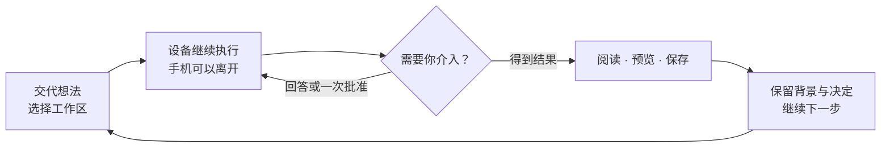
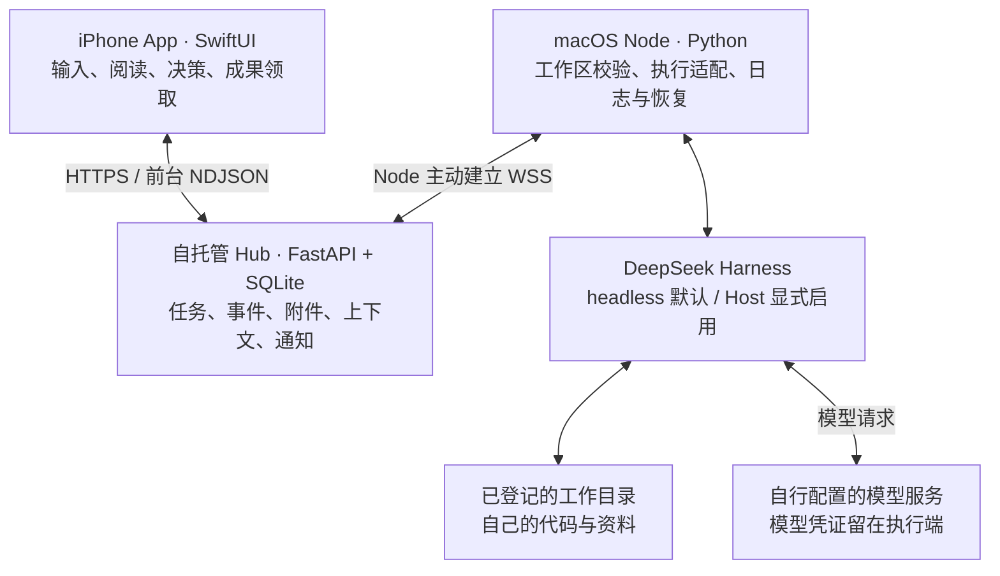

<p align="center">
  
</p>

<h1 align="center">XVIS</h1>

<p align="center"><strong>模型和应用可以更换，核心资料由自己掌握。</strong></p>
<p align="center">原生 iPhone · 自托管中枢 · macOS 执行节点 · DeepSeek Harness</p>

<p align="center">
  <a href="docs/product.md">产品想法</a> ·
  <a href="docs/gallery.md">界面图集</a> ·
  <a href="docs/design.md">设计思路</a> ·
  <a href="docs/architecture.md">技术路线</a> ·
  <a href="docs/progress.md">开发进展</a> ·
  <a href="docs/deployment.md">自行部署</a>
</p>

## 为什么做 XVIS：让积累留在自己手里

我之前的 CC 账号被封了。随之无法取回的，是大量保存在云端的聊天记录、对话和灵感研讨。那些记录里有逐步形成的想法、反复推敲的判断，以及下一次可以接着讨论的起点。账号失去访问权限之后，这些积累也一起失去了入口。

这件事让我开始研究一套把资料保存在自己手里的架构。最初的核心想法就是**解耦**：与具体模型解耦，与云端应用解耦。模型负责提供智能，应用负责提供交互，而对话、灵感、项目背景和成果应有自己掌握的存档。无论模型和软件怎样变化，都应能保留、读取、备份这些资料，并在更换工具后继续使用。

因此，XVIS 把**数据自持、模型可替换、备份与恢复**作为长期设计原则。手机助理、跨设备执行和记忆功能，都是在这份持久积累之上逐步形成的工作方式。

当前已经具备自托管 Hub 的任务与资料存储、执行设备上的日志／DSH 会话，以及文件成果领取。**完整本地归档、通用导出导入、自动备份与恢复演练、跨模型／跨应用迁移仍需推进。** Hub 可以部署在自有云服务器，模型请求仍可能发往外部服务；当前执行也仅适配固定 DSH，不能把解耦目标理解为已经支持任意模型切换。详见 [项目起因与解耦原则](docs/product.md) 和 [实现边界](docs/progress.md)。

## 从手机上的一个想法继续

离开电脑之后，工作往往还没有结束：一个方案需要再推敲，几份资料需要比较，一个项目需要继续推进。XVIS 希望让这些事情可以从手机开始，由自己的执行设备接着完成，在方便的时候把成果交回来。

你可以交代意图、查看进展、回答执行中的问题、决定是否允许某一次操作，再领取文字、图片或文件。下一次继续时，项目背景和已经确认的决定能够成为起点。

它想逐步成为一个**属于个人、能延续工作、交付实际成果的跨设备助理**。目前已经形成原生 iOS 界面、任务与成果中枢、macOS 执行节点的完整源码框架。更多想法见 [为什么做 XVIS](docs/product.md)。

**当前为开发者预览版，采用 MIT 许可。** 需要自行部署 Hub、配置模型访问方式，并通过 Xcode 构建 App。仓库不提供公共服务器、共享模型额度、已签名安装包或模型权重。XVIS 是独立项目，与 DeepSeek 无隶属关系。

## 先看看 App

浅色像一张温暖的纸，深色保留石墨的层次，两种外观共用玉青强调色。下面是当前公开版在 iOS 模拟器中的实际截图，使用本地合成演示数据；图中的任务、设备和成果用于展示界面，不是本次真实模型执行记录。

<table>
  <tr><th>暖纸 · 白天的阅读与思考</th><th>石墨 · 安静的深色工作空间</th></tr>
  <tr>
    <td></td>
    <td></td>
  </tr>
</table>

<table>
  <tr><th>把结果读清楚</th><th>在关键操作前介入</th><th>把成果带走</th></tr>
  <tr>
    <td></td>
    <td></td>
    <td></td>
  </tr>
</table>

[打开完整界面图集](docs/gallery.md)：11 张截图覆盖两种主题、长文表格、历史筛选、中途批准、下一轮队列、人格与手动记忆、项目背景和文件预览，每一屏都配有交互说明。

## 三种开始方式，一条连续的工作线

| 入口 | 适合交代的事情 | 希望得到的成果 |
| --- | --- | --- |
| **灵感研讨** | 一起拆解问题、比较方向、推敲方案 | 可以继续修改的思路、方案和决定 |
| **项目推进** | 了解当前状态、处理具体事项、执行检查 | 已完成工作、验证结果、剩余问题与下一步 |
| **咨询检索** | 查找资料、核对来源、比较信息 | 带依据的回答、对照表、可保存的资料 |

三个入口当前只是可编辑的建议指令，共用同一套 DSH 执行链。点击不会自动发送；“咨询检索”这个名称也不会自动配置搜索服务。实际能调用哪些工具，取决于执行节点及其模型环境。



中途问答、批准和运行中补充需要显式启用 **Host 模式**，目前限定于 `p-xvis-test` 测试工作区。默认 headless 路径继续保留。详细过程见 [一次任务怎样完成](docs/workflows.md)。

## 已经实现什么

以下按公开源码整理，核对日期为 **2026-10-10**。实现范围和环境验收是两件事；逐项证据见 [开发进展](docs/progress.md)。

| 领域 | 当前能力 | 使用前提与边界 |
| --- | --- | --- |
| 原生聊天 | Markdown、连续轮次阅读、草稿、历史搜索与工作区筛选 | 搜索针对已载入记录；更多历史按需加载 |
| 异步执行 | 新建、排队、同会话续接、停止请求、失败重试、重连补齐 | 执行设备需要在线；停止请求需等待确认 |
| 持续交互 | Host 正文流式、中途问答、一次批准、当前轮补充、下一轮队列 | 仅显式 Host 测试工作区；其他项目默认 headless |
| 图片 | 每轮最多 4 张输入、4 张输出；查看、保存、分享 | 单张协议上限 6 MiB；图片内容不会自动脱敏 |
| 文件成果 | TXT、MD、CSV、PDF、DOCX 返回、预览、领取与补传 | 每轮最多 4 个，单文件上限 16 MiB；一般文件输入待开发 |
| 工作延续 | 手动人格／记忆、项目七字段背景、来源记录、进度摘要候选 | 新会话固定快照；候选要审阅并明确保存 |
| 结果与提醒 | 未查看结果、待我处理、通知登记和点击路由 | 真实 APNs 送达尚待证书配置及专项验收 |
| 设备接入 | 短时配对、设备名与指纹确认、独立身份和撤销 | 两个隔离本地 Node 已验证；第二物理设备、Windows 待验 |

## 技术路线：让每一层只承担必要的工作



- **手机**负责表达意图和轻量决策，使用 SwiftUI、Keychain、系统照片选择与文件预览能力。
- **Hub**保存任务事实、事件和成果。漏掉一次通知、离开前台或重新打开 App，都可以回到这些记录。
- **Node**接入指定设备与目录，适配固定 DSH 运行包，维护本地执行日志及恢复状态。
- **DSH**承担模型与工具执行。XVIS 当前坚持单引擎接入，先把一条完整工作链做好。

iOS 最低目标为 17，新材质在 iOS 26+ 启用；构建需 iOS 26 或更新 SDK。Python 使用 3.12+；当前固定 DSH `0.2.1-alpha.1`、Node.js `24.21.0`。这些固定版本是协议适配基线，不应直接换成任意最新版。更多取舍、代码入口和信任边界见 [技术架构](docs/architecture.md)。

## 设计想法

长时间阅读需要安静，远程操作需要确定感。XVIS 把二者放在同一套界面里：回答采用文章式排版，用户输入保持轻气泡；玻璃材质用于浮动导航和输入区；任务状态、待处理请求和文件交付各自有明确位置。

暖纸与石墨分别定义语义颜色，不做简单反色。玉青集中用于主操作、链接和选中态；成功、警示、失败仍使用各自语义色。原创交汇 X 保持固定配色，让两种外观拥有同一个身份。

交互上的细致感来自草稿不轻易丢失、阅读位置不被新内容抢走、批准对象可以核对、文件下载后有完整性检查。动效服务于触摸反馈和层级变化，遵循减少动态效果及减少透明度设置。

[设计说明](docs/design.md)记录了配色、排版、材质、动效、无障碍考虑，以及 Apple、Linear、Things 和移动 DSH 项目分别带来的启发。

## 正在走向哪里

| 阶段 | 想解决的问题 | 当前进展 |
| --- | --- | --- |
| **R1 · 结果交付** | 交代后能离开，回来能拿到结果 | 主链、图片／文件、未查看结果已实现；真实推送待验 |
| **R2 · 工作延续** | 隔天回来，不必重新讲一遍背景 | 项目背景与摘要已实现；条目级记忆与来源管理待开发 |
| **R3 · 日常流程** | 把常做的事情变得更顺手 | 分享入口、一般文件输入、少量流程、路径预设和语音待开发 |
| **R4 · 设备协作** | 明确交给哪台设备，桌面能顺手接上 | 配对／撤销已有实现；第二物理节点与桌面交接待推进 |
| **R5 · 有限主动跟进** | 成熟工作按约定回来继续 | 规划阶段；依赖可重复的流程和明确停止机制 |

近期重点是完善日常输入与交付体验，并补齐真实 APNs、相机扫码、物理第二节点和完整手机交互验收。语音对话和项目路径预设已进入计划，尚未作为现有能力发布。[完整路线图与完成标准](docs/roadmap.md)

## 从哪里开始阅读与运行

| 你关心什么 | 推荐入口 |
| --- | --- |
| 项目的目的、使用场景与长期目标 | [产品思路](docs/product.md) |
| App 长什么样、每一屏怎样用 | [界面图集](docs/gallery.md) |
| 为什么选暖纸、石墨、玉青与这些交互 | [视觉与交互设计](docs/design.md) |
| 请求、执行、批准、文件、记忆如何流转 | [工作流程](docs/workflows.md) |
| 协议、模块、执行模式与技术取舍 | [技术架构](docs/architecture.md) · [接口索引](docs/protocol.md) |
| 哪些做完、哪些验证过、哪些还在计划里 | [开发进展](docs/progress.md) · [路线图](docs/roadmap.md) |
| 如何搭起自己的环境 | [部署指南](docs/deployment.md) · [iOS 构建](ios/README.md) |
| 数据去哪儿、截图和记忆怎样处理 | [隐私与数据流](docs/privacy.md) · [常见问题](docs/faq.md) |

先运行不调用模型的检查：

```sh
git clone https://github.com/Doubixilin/XVIS-OpenSource.git
cd XVIS-OpenSource
python3.12 -m venv .venv
.venv/bin/python -m pip install -r requirements-lock.txt
.venv/bin/python scripts/check.py
```

首次安装会下载 Python 依赖；检查本身使用合成数据、临时目录和 loopback 服务，不需要模型凭证。要实际使用 App，请继续部署自己的 HTTPS Hub、准备固定 DSH 运行包和独立配置，再构建 iOS App。建议先使用无敏感数据的测试目录。

## 验证与使用边界

公开源码的 [首轮云端 CI](https://github.com/Doubixilin/XVIS-OpenSource/actions/runs/38022818930) 已通过：**212 项 Python 回归、22 项解析夹具检查、95 项 iOS XCTest**。普通签名模拟器 App 的安装、启动和首次未配置连接界面也已核对。详细环境、提交及检查范围见 [验收记录](docs/validation.md)。

当前面向单个可信用户，自托管需要自行维护服务器和权限。模型请求可能发送给配置的服务方，自托管 Hub 不等于本地模型推理，也不等于端到端加密。目录登记不是操作系统沙箱；任务完成和文件校验通过仍不保证成果内容正确。通知送达、相机、蜂窝、触觉与第二物理设备有独立的待验事项。

欢迎研究、修改和贡献。提交问题时，请使用合成复现材料，避免附上凭证、私人任务、原始资料或未经检查的截图。[贡献指南](CONTRIBUTING.md) · [安全说明](SECURITY.md)

## 许可与致谢

XVIS 源码、本文档及作者原创 X 图标采用 [MIT License](LICENSE)。DeepSeek Harness、Node.js、Python 依赖和 Apple 框架遵守各自许可。原生 App 与 Node–Hub 协议由本项目实现；参考项目未作为源码混入仓库。

[第三方软件与参考项目](THIRD_PARTY_NOTICES.md) · [设计与工程参考](docs/references.md) · [图像来源说明](docs/assets.md)
