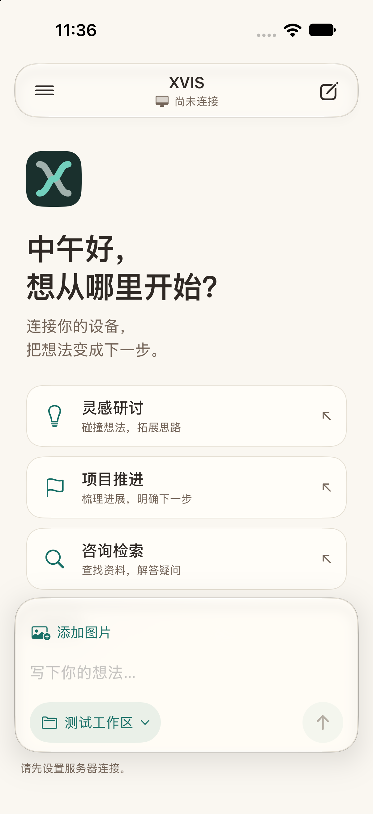

# XVIS

一个可自行部署的私人 AI 助理：在 iPhone 上提出想法，由你自己的执行设备继续工作，把结果带回手机。

原生 SwiftUI 界面，浅色暖纸、深色石墨、玉青强调色。当前采用 **iPhone → 自托管 Hub → macOS Node → DeepSeek Harness**，仅接入 DSH 单引擎。XVIS 是独立项目，与 DeepSeek 无隶属关系。

**开发者预览版。** 需要自己部署服务器、配置模型访问方式，并用 Xcode 构建 iPhone App。项目不提供公共中枢、共享模型额度或托管账户。



## 可以做什么

- 用“灵感研讨”“项目推进”“咨询检索”开始对话，切换已登记的工作区。
- 在手机离开前台后由执行设备继续任务，回来补齐结果；查看历史、执行步骤和未查看成果。
- 在测试工作区启用 Host 后，接收流式正文，回答中途问题、批准或拒绝操作，补充当前轮指令或管理下一轮队列。
- 发送图片，接收图片和文件，预览、保存或分享成果。
- 手动编辑人格与记忆、项目背景和进度；新会话固定资料快照，旧会话沿用原快照。
- 通过短时链接或二维码确认新节点，并撤销节点授权。

Host 目前仅允许显式配置的 `p-xvis-test`；其他项目默认 headless。普通聊天入口名称不代表自动启用了联网搜索或额外工具。

## 开始使用

1. 阅读 [部署指南](docs/deployment.md)，安装 Python 依赖、部署自己的 HTTPS Hub。
2. 准备固定版本的 DSH 和 Node.js，登记一个测试工作区并启动 macOS Node。
3. 按 [iOS 构建指南](ios/README.md)构建 App，填写自己的服务器地址与 App 凭证。
4. 先用无敏感数据的测试目录验证任务、结果和停止行为，再登记自己的工作目录。

```sh
python3.12 -m venv .venv
.venv/bin/python -m pip install -r requirements-lock.txt
.venv/bin/python scripts/check.py
```

上述检查使用合成数据和 loopback 服务，不需要模型凭证。真实模型测试是单独的显式操作，可能产生费用。

## 文档

- [架构与边界](docs/architecture.md)
- [部署与配置](docs/deployment.md)
- [接口索引](docs/protocol.md)
- [隐私与数据流](docs/privacy.md)
- [测试及已知限制](docs/validation.md)
- [开发计划](docs/roadmap.md)
- [贡献指南](CONTRIBUTING.md) · [安全说明](SECURITY.md) · [第三方说明](THIRD_PARTY_NOTICES.md)

## 当前限制

当前面向单个可信用户，不提供多租户账户隔离。模型输出需要检查；“任务完成”不保证成果内容正确。APNs 代码需要自行配置证书，真实 Apple 推送尚未完成独立验收；物理第二设备、Windows 节点、真机光学扫码及完整手机交互仍有待验证项。语音对话、一般文件输入、路径预设管理和系统分享入口属于后续计划。

## 许可

XVIS 源码使用 [MIT License](LICENSE)。第三方软件保留各自许可，见 [THIRD_PARTY_NOTICES.md](THIRD_PARTY_NOTICES.md)。
