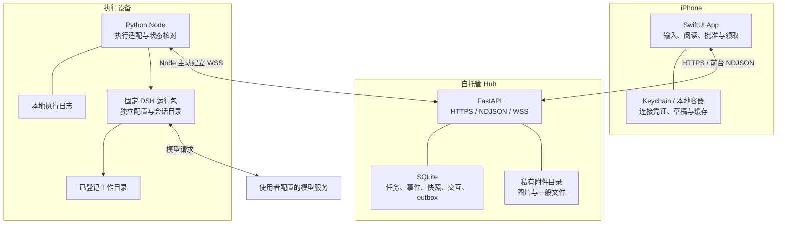

# 技术架构与取舍

[返回首页](../README.md) · [工作流程](workflows.md) · [接口索引](protocol.md) · [部署指南](deployment.md)

## 架构的起点是解耦

作者因 CC 账号被封而无法取回云端积累的对话与灵感，开始研究能够自行保存资料的架构。XVIS 因此把任务和资料的持久化，与模型调用和交互入口分层：希望将来更换模型或应用时，已有资料仍可读取和复用。完整起因见 [产品思路](product.md)。

当前已经建立 App → Hub → Node → DSH 的分工。**分层提供了解耦的基础，尚未消除全部实现依赖**：Hub 使用自己的数据库结构，Node 依赖固定 DSH 协议，会话续接依赖 DSH 的格式与身份；Host 还固定选择 `deepseek-official / deepseek-flash`。通用模型切换、跨引擎会话迁移和其他 App 接手都不是当前能力。

后续要保留的核心，是可独立读取的原始记录、已确认资料与成果，以及它们之间的来源关系。摘要和向量索引用于使用这些资料，应能从保留的内容重建；这是一项设计约束，当前没有自动向量记忆或完整可移植档案实现。

## 四层结构，围绕一份可恢复的任务记录

手机负责意图、阅读和决定；Hub 保存跨连接存在的任务事实；Node 把任务接到真实设备与目录；DSH 负责模型循环和工具执行。Hub 可以部署在使用者自己的 HTTPS 服务器上，Node 主动向外连接，无需把本机执行端口直接暴露到公网。

## 为什么采用这条路线

| 技术选择 | 对当前目标的帮助 | 约束 |
| --- | --- | --- |
| SwiftUI 原生 App | 使用系统照片、文件预览、分享、Keychain、动态字体与材质 | 构建、签名与设备验收需要 Apple 工具链 |
| FastAPI + SQLite | 对个人规模提供清晰的 HTTP 协议和持久化记录 | 当前部署使用单 Hub worker，不能直接当多实例集群运行 |
| Node 主动 WSS 连接 | 适应执行设备在内网、移动端随时离开的结构 | 需要重连、心跳、幂等与状态核对 |
| 固定 DSH 单引擎 | 集中验证会话、事件、取消和交互语义 | 升级运行包需要重新检查适配契约 |
| 独立运行目录与模型配置 | 不依赖开发者桌面环境的隐式状态 | 使用者需准备自己的运行包和模型访问方式 |
| 任务／附件／交互分别保存 | 执行、传输与人工决定能独立恢复和展示 | 状态数量增加，需要保持协议一致 |

项目没有再实现一套模型规划引擎。适配层负责设备、身份、协议和交付；复杂度只在当前工作链确实需要的地方增加。

## 两种 DSH 执行模式

| | headless | Host |
| --- | --- | --- |
| 当前定位 | 默认执行路径 | 显式启用的持续交互路径 |
| 工作方式 | 启动 DSH 进程并解析输出事件 | 通过 Host 协议管理会话与双向交互 |
| 能力 | 任务执行、状态、结果、会话续接 | 另有中途问答、一次批准、正文增量、steer 与 queue |
| 当前范围 | 已登记并可用的工作区 | 限定显式配置的 `p-xvis-test` |
| 配置隔离 | 独立 DSH home | 单独 `host_home` |
| 旧会话 | 按原模式续接 | 不把旧 headless 会话静默转换成 Host |

当前固定 DSH 包为 `0.2.1-alpha.1`、Node.js 为 `24.21.0`；上游源码验证基线为 `5badb15009ae1756c3afe0ae0cef1faafc290ccc`。Python 使用 3.12+；iOS 最低部署目标 17，新材质 API 需要 iOS 26+ 并保留旧系统路径。准确配置见 [部署指南](deployment.md)。

headless 使用独立 DSH 配置；Host 的模型选择见 [dsh_host.py](../node/dsh_host.py)。配置模型访问凭证与验证替代模型是不同工作，当前没有承诺任意兼容 API 或本地模型均可使用。

## 数据分别留在哪里

| 数据或身份 | 主要位置 | 边界 |
| --- | --- | --- |
| App 连接凭证 | iOS Keychain，按服务器绑定 | 不是模型 API Key |
| 草稿、阅读状态、下载缓存 | App 本地容器 | 不是服务端任务事实的替代品 |
| 任务、事件、交互、快照、通知队列 | Hub SQLite | 中枢可读取业务内容；没有端到端加密承诺 |
| 图片与文件成果 | Hub 私有附件目录与 App 领取缓存 | 需要鉴权；数据库与附件一起备份 |
| Node 身份 | 节点私有配置；Hub 保留凭证校验材料 | 每个节点独立，可撤销 |
| 执行日志与 DSH 会话 | 执行设备私有目录 | 重启时用于核对；不得把未知任务静默重跑 |
| 模型配置与凭证 | 执行端独立 DSH 环境 | 不通过 App 或 Hub 分发给模型服务 |
| APNs provider 证书／私钥 | 运营者配置的 Hub 私有位置 | 当前支持证书路径；真实送达另行验收 |

这是一套单个可信所有者使用的系统。多个 App 凭证不是独立租户账号，项目上下文和共享资料也没有多租户隔离设计。TLS 保护传输不等于中枢无法读取内容；自托管不等于本地推理。完整说明见 [隐私与数据流](privacy.md)。

## 数据自持还需要导出、备份与恢复

当前 Hub 保存本系统接收的任务、事件、正文、资料快照与附件，Node 另有执行日志和 DSH 会话。它们不是某个模型厂商聊天账号里的唯一记录，但也还不是覆盖一切的通用存档：系统不归档模型隐藏推理，没有导入既有云端聊天记录，也没有跨应用完整导出／导入流程。

Hub 可部署在自有云服务器，所以“由自己管理”不能写成“全部资料已经保存在本地电脑”。要实现完整的本地长期存档，仍需定义覆盖范围和独立副本；手机缓存不能替代它。

| 恢复能力 | 当前范围 | 尚未具备 |
| --- | --- | --- |
| 连接恢复 | App 重开补齐、Node 日志与回执核对 | 不保证恢复正在执行的进程或中断的 Host 请求 |
| 升级保护 | Linux 安装脚本备份现有 SQLite 数据库与服务配置，并提供发布失败回退 | 不是附件、节点会话、工作目录的完整灾备包 |
| 成果保存 | 文件可鉴权领取、校验并分享 | 不是全部会话与资料的独立归档 |
| 灾备恢复 | 部署说明要求运营者备份数据库和附件 | 自动备份、版本化归档、异地副本及空白环境整链恢复尚未交付 |

后续备份应覆盖 Hub 数据库与附件的一致版本、Node 执行日志、DSH 会话和需要保存的项目文件，并记录格式版本、关联关系和完整性校验。凭证需独立保护，不随可读知识基线公开或分发。SQLite 的一致性备份也不能由随手复制一个正在写入的数据库文件替代。

是否采用 NAS、系统文件历史或经过筛选的加密异地副本，取决于实际部署；早期方案中的这些选择没有自动成为已安装能力。恢复需要在独立环境验证旧记录和附件可读，并避免重放已完成任务或失效批准。具体目标见 [路线图](roadmap.md)。

## 关键一致性规则

1. **提交有稳定身份。** 同一次任务提交在回执丢失后可以查询／重试，不因网络重发创建重复工作。
2. **任务绑定设备和项目。** 使用 `(node_id, project_id)` 标识工作区。默认目录不可用时停止并报告，不自动换项目或节点。
3. **控制命令有独立回执。** Hub 接收、Node 转发和引擎实际消费分别确认。批准绑定运行实例、会话和调用，过期请求不会进入新实例。
4. **上下文快照固定。** 新根会话采用当时的共享资料与项目背景；续接和重试沿用原快照。项目资料保存使用版本检查，冲突时不丢弃编辑稿。
5. **交付独立于执行终态。** 文件需要类型、大小与 SHA-256 核验，缓存损坏可以补传。
6. **恢复承认未知。** 节点断线、进程退出与任务停止不能互相替代。Host 重启中断旧交互，避免把旧批准恢复到新运行中。
7. **移动端允许断开。** 前台增量通道失效时回退轮询；重开从服务端补齐。没有永久 iOS 后台监听承诺。

目录登记用于路由与配置检查，不能代替操作系统沙箱。工具能访问什么，仍受 DSH 工具实现、执行账户与系统权限影响。参见 [安全说明](../SECURITY.md)。

## 从代码哪里开始

| 关注点 | 入口 |
| --- | --- |
| App 状态、任务与恢复 | [AppStore.swift](../ios/XVIS/AppStore.swift)、[APIClient.swift](../ios/XVIS/APIClient.swift)、[Persistence.swift](../ios/XVIS/Persistence.swift) |
| 聊天、阅读与设计系统 | [ConversationViews.swift](../ios/XVIS/ConversationViews.swift)、[DesignSystem.swift](../ios/XVIS/DesignSystem.swift) |
| 问答、批准与持续控制 | [InteractionViews.swift](../ios/XVIS/InteractionViews.swift)、[interactions.py](../hub/gateway/interactions.py)、[continuous.py](../hub/gateway/continuous.py) |
| Hub HTTP 与持久化 | [app.py](../hub/gateway/app.py)、[v1_repo.py](../hub/gateway/v1_repo.py) |
| 图片与文件交付 | [images.py](../hub/gateway/images.py)、[artifacts.py](../hub/gateway/artifacts.py)、[FileViews.swift](../ios/XVIS/FileViews.swift) |
| 助理与项目资料 | [assistant_profile.py](../hub/gateway/assistant_profile.py)、[project_context.py](../hub/gateway/project_context.py) |
| 通知与未查看结果 | [notifications.py](../hub/gateway/notifications.py)、[inbox.py](../hub/gateway/inbox.py) |
| 设备配对与登记 | [pairing.py](../hub/gateway/pairing.py)、[node_registry.py](../hub/gateway/node_registry.py) |
| Node 执行适配 | [dsh_agent.py](../node/dsh_agent.py)、[dsh_runner.py](../node/dsh_runner.py)、[dsh_host.py](../node/dsh_host.py) |
| 执行日志与进程控制 | [dsh_store.py](../node/dsh_store.py)、[dsh_process.py](../node/dsh_process.py) |

## 部署和扩展时保持的边界

Hub 使用一个 worker 和持久私有数据目录；数据库及附件必须一致备份。Node 使用明确登记的目录与固定运行包。协议扩展先约定兼容行为，再更新各端，避免静默改动线上契约。

目前经过重点适配的是 macOS。两个隔离本地节点的配对验证不能替代第二物理设备、Windows 的进程树终止或平台权限验收。把摘要带到新设备创建任务，也不是迁移原来的 DSH 会话。后续工作见 [路线图](roadmap.md) 和 [验证边界](validation.md)。
