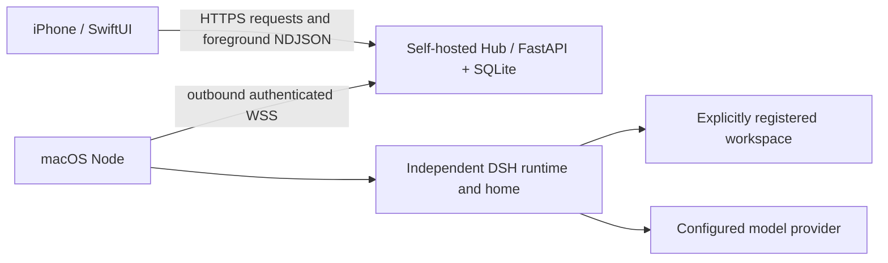

# Architecture

The Hub persists tasks, events, attachments, context snapshots, user responses, control commands and notification outboxes. Use one Hub worker and a persistent private data directory. Its SQLite database and attachment files must be backed up together.

The Node validates registered directories and runtime versions, starts the pinned DSH runtime, forwards real events, and keeps a local journal for reconciliation. It never silently reruns an unknown old task after a restart. The Hub's task receipt and the Node's actual execution are distinct states.

The App stores endpoint-bound credentials in Keychain and local drafts/caches in its protected container. It reads current server state after reconnecting. Foreground streaming falls back to polling when unavailable. The node may continue working when the phone locks; that does not imply continuous iOS background execution.

## Execution modes

`headless` is the default. Each task starts a DSH process; follow-up tasks preserve the previous session and context snapshot. `host` adds real question/approval responses, incremental assistant text, steer and queue control. It is presently gated to the explicitly configured `p-xvis-test`, with a separate `host_home`. Existing headless conversations remain headless.

Projects are identified by `(node_id, project_id)`. An offline or unavailable default workspace cannot silently redirect work to another device or directory. A new task with a summary on another machine is not migration of the original session.

This is a single-owner system. App credentials are not separate user accounts, and shared context is not tenant-isolated. See [privacy](privacy.md) and [security](../SECURITY.md).
