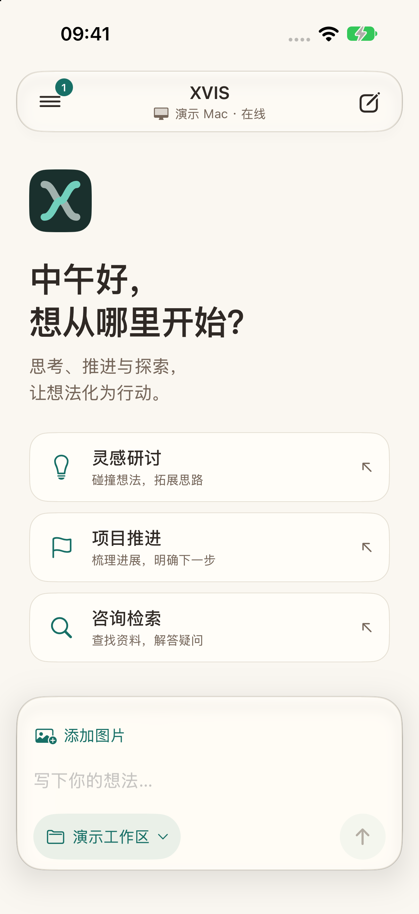
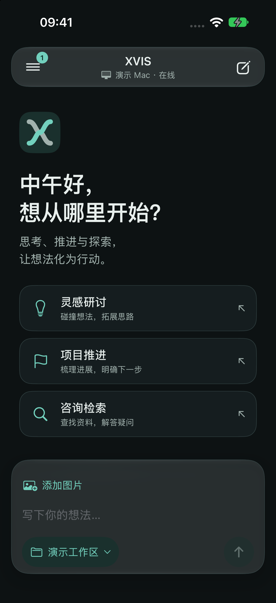
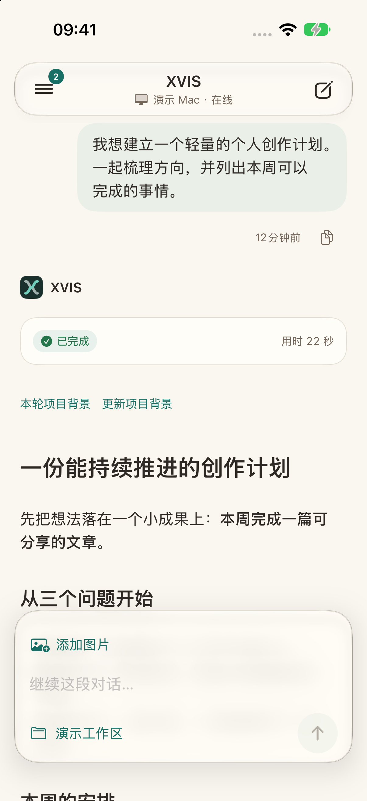
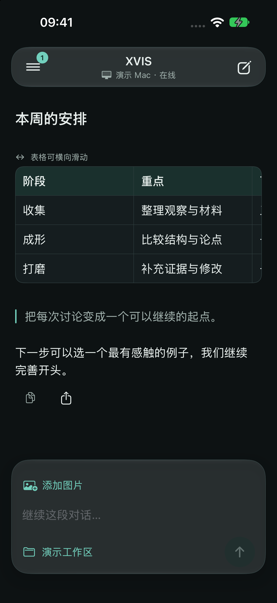
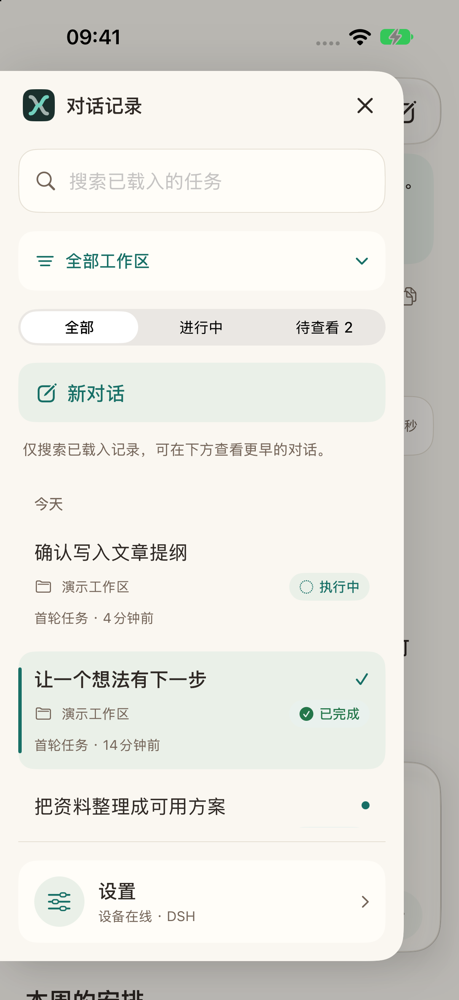
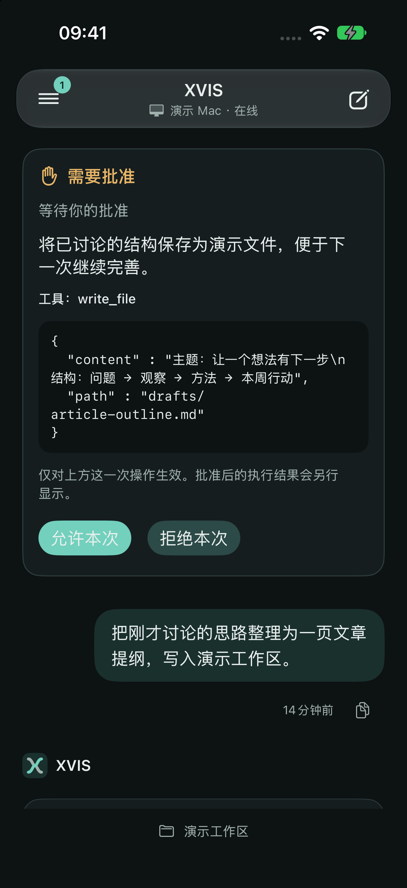
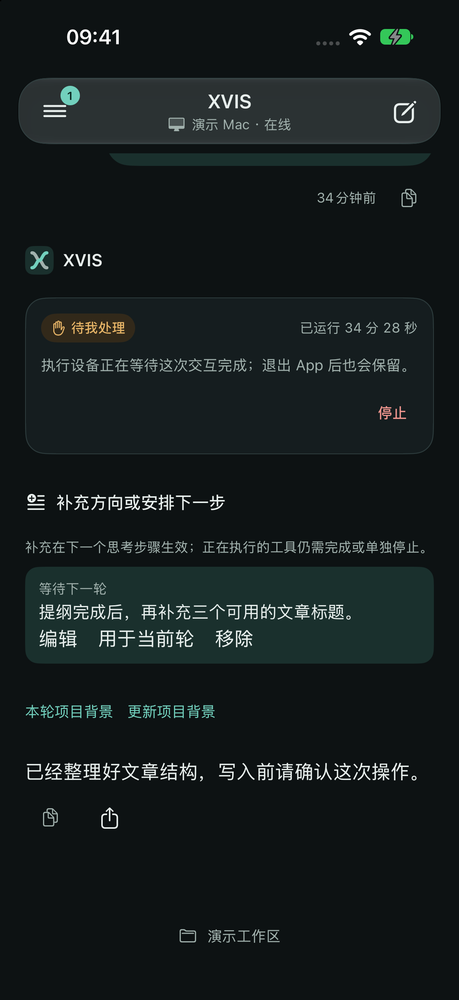
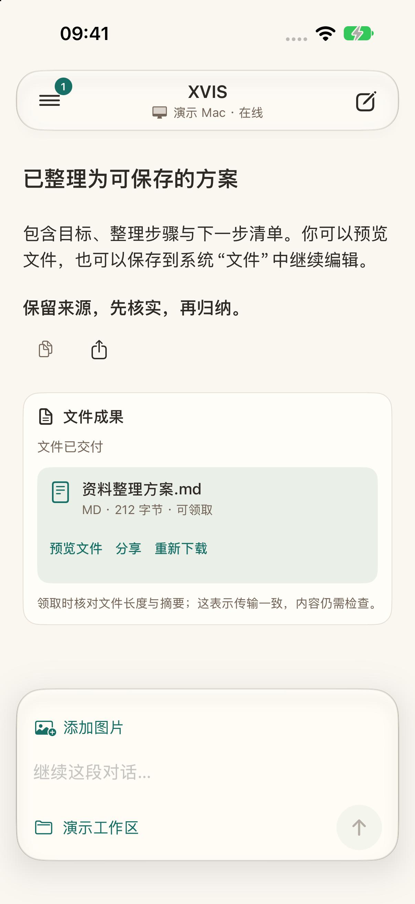
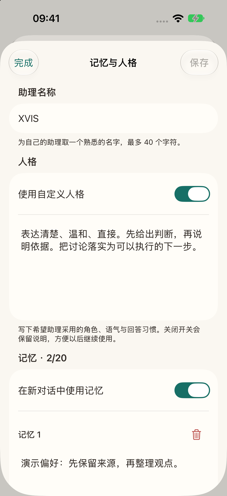
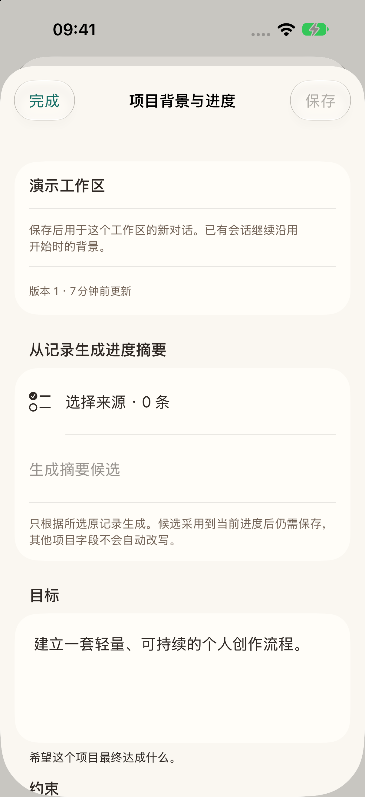

# XVIS 界面图集

[返回首页](../README.md) · [设计说明](design.md) · [工作流程](workflows.md) · [开发进展](progress.md)

以下是当前公开源码构建的原生 iOS App 实际截图，使用本机合成演示服务。界面是真实运行的 App，任务、设备、记忆和文件均为展示用资料；没有调用模型或连接生产 Hub。

## 01 · 从一个想法开始

欢迎页提供“灵感研讨”“项目推进”“咨询检索”三个入口。点击后形成可编辑草稿，用户可以继续补充，不会直接发送。底部能看见当前设备与工作区，随时知道将把事情交给哪里。

<table>
  <tr><th>暖纸</th><th>石墨</th></tr>
  <tr>
    <td></td>
    <td></td>
  </tr>
</table>

暖纸和石墨分别定义背景、正文、辅助文字与表面颜色。可以跟随系统，也可以在设置中固定选择。问候随时间变化；截图状态栏时钟统一显示为 9:41，便于比较两种外观，不代表实际采集时刻。

## 02 · 把回答读成一篇文章

<table>
  <tr><th>指令与回答</th><th>长文中的表格与引用</th></tr>
  <tr>
    <td></td>
    <td></td>
  </tr>
</table>

回答采用文章式布局，保留标题、段落、列表、引用、代码与表格。自己的指令保持轻气泡，任务状态和耗时可以扫读。项目背景入口与输入区留在明确的位置，便于接着推进。

截图中的文章是合成演示文本；它说明正文呈现方式，不作为写作质量或真实模型执行的证据。长回答、连续轮次和表格的实现入口见 [设计说明](design.md)。

## 03 · 从历史中回到一件事

侧栏提供搜索、状态与工作区筛选、相对时间和未查看提示。当前历史以任务条目组织，搜索作用于已经载入的数据；不是服务端全量检索。设置入口也集中在这里。

## 04 · 需要决定时，看到具体操作

Host 模式的批准卡显示这次请求涉及的工具和参数，再由使用者决定“允许一次”或“拒绝”。问答和批准具有独立的等待、提交和确认状态。当前 Host 只对显式测试工作区开放。

此屏是合成待处理请求的视觉展示；没有通过演示按钮写入任何真实项目文件。真实链路的集成证据与限制见 [进展](progress.md)。

### 继续补充方向，安排下一轮

同一个任务下可以看到当前状态与后续队列。用户可以补充当前轮方向，或者把要求留到下一轮；尚可修改的条目提供编辑、用于当前轮和移除入口。引擎接收与实际消费分别核对，不把“已入队”显示成“已经执行”。此屏同样来自合成演示状态。

## 05 · 结果可以领取与带走

<table>
  <tr><th>成果卡片</th><th>打开文件</th></tr>
  <tr>
    <td></td>
    <td></td>
  </tr>
</table>

文件有独立于任务的交付状态。下载后核对体积和 SHA-256，失败可以重新领取。TXT、MD、CSV、PDF、DOCX 是当前支持的输出类型；不同类型使用文本查看或系统预览，再通过系统分享交给其他 App。

这里实际下载并打开的是合成的 212 字节 Markdown 文件。文件完整性一致并不意味着内容质量已经被验证。

## 06 · 明确维护助理资料

名称、人格和手动记忆由使用者直接维护。示例中的文字与条目均为合成资料。新会话固定资料快照，旧会话继续沿用原快照；设置不会改变模型凭证或扩大执行权限。

当前已有手动条目编辑，自动提取、来源管理和更细的记忆作用域仍在计划中。

## 07 · 给项目留下可继续的背景

项目背景有目标、约束、材料、决定、进展、待解决问题、下一步七个字段，按设备和项目隔离。可以选择任务记录生成候选，审阅后采用到编辑稿，再明确保存。版本冲突时保留用户的编辑内容。

这屏展示编辑结构和摘要入口，不代表演示服务实际生成了摘要。当前产品强调可审阅的资料，避免把模型猜测直接变成长期记忆。

## 截图来源与复核范围

| 项目 | 说明 |
| --- | --- |
| 采集日期 | 2026-10-10 |
| App 来源 | 公开源码业务基线 `a316d5a`；随后文档提交未改变 App |
| 环境 | iPhone 18 Pro 模拟器，iOS 27，默认文字大小 |
| 图像 | 1206 × 2622 原始 PNG；在文档中仅缩放显示 |
| 内容 | 合成任务、演示设备与工作区、合成资料及文件 |
| 网络 | 本机 loopback HTTPS 演示服务，无真实模型或生产中枢 |
| 许可 | 本项目截图及原创 X 图标按仓库 MIT 许可提供；系统框架权利归各自所有者 |

没有把设计稿冒充成已经运行的功能，也没有在截图上拼接未实现控件。图集不代替真实 APNs、相机、蜂窝网络、触觉或第二物理设备的验收。完整边界见 [验证记录](validation.md) 与 [图像来源](assets.md)。
