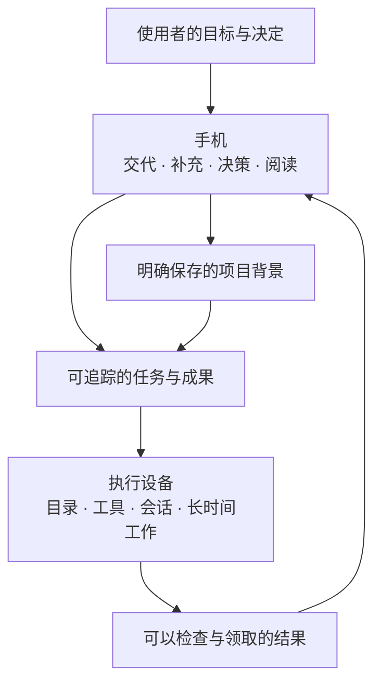

# 为什么做 XVIS

[返回首页](../README.md) · [工作流程](workflows.md) · [设计思路](design.md) · [开发进展](progress.md)

## 把一次交谈变成可以继续的工作

XVIS 的起点是个人在手机、电脑和资料之间来回切换的日常。很多工作并不适合在手机上全部完成，但手机很适合表达一个意图、补充一张截图、回答一个问题，或者在空闲时查看结果。

因此，项目希望形成一个持续的过程：人在方便的时候交代事情，设备利用已经准备好的环境执行，成果在需要的时候可领取，下一次讨论能接住上一次的背景。它同时覆盖想法讨论、资料研究、日常事务和项目推进；项目并不限于代码仓库。

这里的“私人”指向明确的服务对象、资料范围和协作习惯。使用者自行掌握中枢与执行节点，决定接入什么目录、采用什么模型，以及哪些信息值得保留。它并不表示所有推理都发生在本地；模型与数据边界见 [隐私说明](privacy.md)。

## 希望带来的三种变化

### 工作完成后，结果能交到手里

一段回答、一份文档、一张图片都可以成为成果。用户应当知道任务做了什么，结果保存在哪里，如何查看或继续修改。执行成功、文件上传完成、手机领取成功需要分别表达。

当前已经有 Markdown 阅读、图片收发、一般文件返回、预览与分享，以及独立的未查看结果。后续输入资料和重复流程也会围绕可检查、可使用的成果发展。

### 重新开始时，不必反复解释背景

人格决定沟通习惯，个人资料提供稳定偏好，项目背景保留目标、约束、决定和进度。它们有不同的作用范围，也有不同的更新节奏。

当前先提供手动维护和新会话快照。项目摘要可以从选定记录生成候选，但需要用户审阅、采用并保存。条目来源、逐条记忆引用与自动提取属于后续阶段。

### 经常做的事情，逐步减少操作

从其他 App 分享一段资料、选择预设项目、用语音继续一个话题、按固定格式领取报告，都是后续希望改善的日常入口。只有某个流程已经反复产生可用成果，才适合进一步约定周期性跟进。

## 手机与执行设备怎样分工

手机离开前台后，已经接受的任务由执行节点继续处理；重开时从中枢补齐。执行设备需要保持可用，项目没有承诺唤醒关机电脑、无限后台运行手机进程或自动替换失联节点。

桌面接手复杂编辑和精确会话交接是后续目标。当前可以把文件带回桌面继续处理，但不能把文件分享说成已经实现桌面 App 接力。

## 三种场景的理想交付

| 场景 | 示例意图 | 对结果的要求 | 当前与后续 |
| --- | --- | --- | --- |
| 灵感研讨 | “一起完善这个文章想法，比较两种结构。” | 保留备选方向、选择依据和下一步 | 文字对话与文件输出已有；专用写作流程仍需实践 |
| 项目推进 | “核对当前进度，处理一个具体问题。” | 说明实际修改、检查结果和剩余问题 | 注册工作区执行、背景与来源记录已有 |
| 咨询检索 | “比较这几份材料，保留可以核查的来源。” | 区分资料事实、推断和未核实信息 | 可通过已配置 DSH 工具执行；专门检索流程与工具准备仍由使用者配置 |
| 日常延续 | “接着昨天的目标，再推进一小步。” | 同项目接住上下文，不混入其他项目要求 | 原会话续接与项目快照已有；条目级记忆继续规划 |

这些是产品发展的使用场景，不是对任意任务成功率的保证。首页三个入口只帮助形成草稿，并不会暗中增加权限或工具。

## 关键选择与代价

| 选择 | 期望收益 | 需要承担的代价 |
| --- | --- | --- |
| 原生 iPhone 入口 | 阅读、输入、文件、照片和系统交互连贯 | 需要 Xcode、签名与平台专项验证 |
| 自托管 Hub | 有稳定的任务事实与结果入口，移动端可以断开 | 需要服务器、TLS、备份和维护 |
| 目录明确登记 | 能看清任务交给哪个设备和项目 | 初次配置更谨慎；目录映射不等于 OS 沙箱 |
| 固定 DSH 单引擎 | 集中处理一套运行协议、会话和工具语义 | 受固定运行包能力与兼容性约束 |
| 手动资料先行 | 背景可读、可改、可审阅，减少错误记忆沉淀 | 需要用户维护；尚未自动学习全部历史 |
| 关键介入有独立状态 | 问题、批准、执行和交付不会混为一谈 | 需要处理过期、重复答复、断线与回执不明 |

## 产品原则

**交付可检查的结果。** 不用一个“完成”标签遮住未交付附件、失败步骤或内容需要核实的事实。

**重要背景由人确认。** 模型可以建议摘要和下一步，持久资料需要有明确保存动作；人格和记忆不能扩大执行权限。

**界面安静，关键状态清楚。** 普通进展留在任务中；需要回答、批准或领取成果时有明确入口。视觉风格和交互逻辑共同服务于长期使用。

**先打通一条小而完整的工作链。** 路线按结果交付、工作延续、日常流程、设备协作、有限主动跟进逐步展开。第三、四阶段可按真实需求调整。

**失去联系时承认未知。** 节点离线不表示进程已停止，发出控制命令不表示引擎已经消费。用户应能看到等待、失败和需要核对的状态。

## 长期目标与现在的位置

长期希望形成的是一种熟悉的个人协作关系：它知道当前项目的背景，能在合适设备上工作，把成果带回来，并在明确约定下继续跟进。

当前已经完成这条路线的执行、阅读、交付和部分工作延续基础。自动记忆、语音对话、成熟流程、桌面交接和主动跟进仍需逐项实现与验证。详细顺序与完成标准见 [路线图](roadmap.md)。
