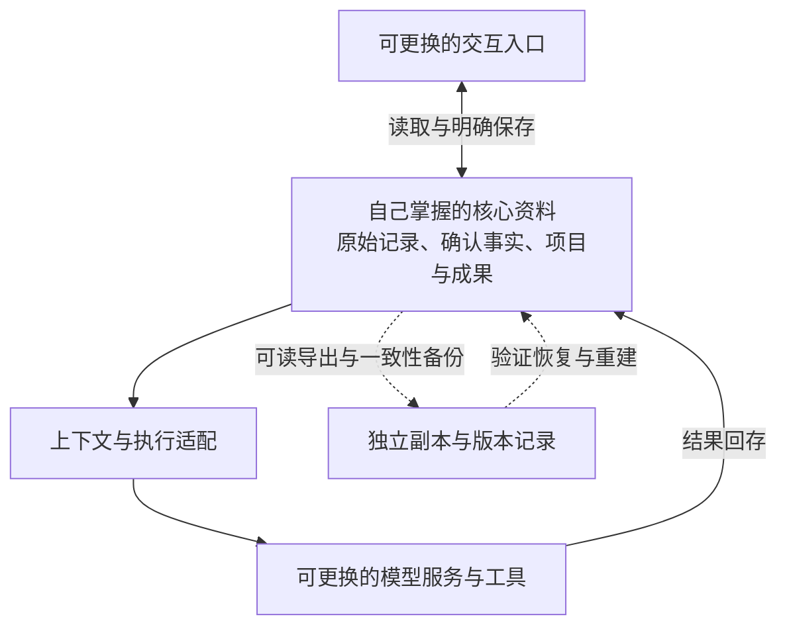
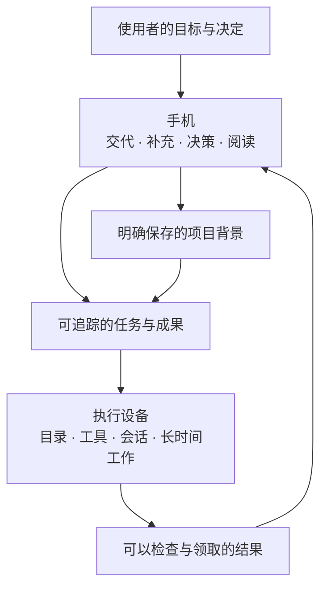

# 为什么做 XVIS

[返回首页](../README.md) · [工作流程](workflows.md) · [设计思路](design.md) · [开发进展](progress.md)

## 起因：一次封号，让积累失去了入口

我之前的 CC 账号被封了，大量存在云端的聊天记录、对话和灵感研讨也随之无法取回。对我来说，这些内容是长期思考留下的积累：讨论过的方向、逐渐明确的需求、已经作出的判断，以及还想继续研究的问题。

这段经历让我意识到，核心资料的保存和读取不能只依赖一个账号或一款云端应用。我希望研究一套以本地保存为出发点的架构，把原始记录、重要资料和成果掌握在自己手里。即使某个账号不能再用，某款软件停止服务，或者决定换一个模型，之前的积累也应当能够保留下来。

**最初的核心想法是解耦：模型和软件不断变化，核心资料始终由自己掌握。** 这是 XVIS 的设计目标，也是评估后续功能是否值得做的一条依据。

## 解耦具体意味着什么

### 资料与具体模型解耦

模型是处理资料、提出建议和执行任务的一种能力来源。原始对话、已确认的事实、项目背景和成果，应有独立于模型服务商账号的存储。更换模型时，带走已有资料，让新工具在这些积累上继续工作。

资料的可携带性需要单独建设。更换 API Key、模型配置或执行引擎，不等于原会话状态、工具调用语义和全部上下文可以原样续接。当前 XVIS 仍是固定 DSH 单引擎；Host 路径指定 `deepseek-official / deepseek-flash`，没有任意模型选择器或跨引擎会话迁移能力。

### 资料与云端应用解耦

聊天界面是使用资料的入口。希望长期保留下来的内容，需要自己能够管理的存储、可解释的结构，以及能被其他工具读取的导出格式。更换手机 App 或某款云端软件后，历史资料仍应可找、可读、可继续利用。

当前 App 已通过自己的 Hub 读取任务和资料，减少了对模型厂商聊天界面的依赖；但 Hub 数据结构与 DSH 会话仍各有自己的格式，通用导出导入和其他应用接手尚未实现。手机缓存也不能承担完整档案的职责。

### 资料的存续与单台设备解耦

保存在自己的机器上，仍可能遇到磁盘损坏、误删或设备不可用。数据自持还需要备份、版本记录和恢复演练：知道副本在哪里，知道它包含什么，并实际验证能否从副本重建资料。

当前具备持久化与部分故障恢复基础，部署脚本也提供升级前数据库备份和发布回退；完整的本地档案、多层副本和异机恢复仍是后续工作。不能把断线补齐记录、回退代码版本或文件哈希一致，当作完整灾备已经通过。

这张图表达长期设计关系，不是当前功能完成图。现阶段只有原生 App 与固定 DSH 执行路径；图中的通用可替换能力、完整归档及备份恢复链路仍需开发和验证。

## 两份早期文档留下的原则

2026-07-31 的《跨设备多智能体共享记忆中心讨论初稿》提出，记忆原文、索引与治理记录应由自己保存；已经确认的事实要有 SQLite、Git／Markdown 等可追溯载体；检索索引不能成为唯一事实源。它还讨论了本地副本、NAS 应用一致性备份、文件历史与经过筛选的异地副本，各自负责不同的恢复需要。

2026-08-21 的《项目总设计与实施方案》进一步把“服务商可替换性”和“数据自持”列为核心目标：存储、调度和协议由自己掌握，智能能力由执行工具或模型服务提供；SQLite 保存运行记录，Git／Markdown 保存可读、可审阅的知识与成果。

本次介绍承接这些原则。早期讨论中的共享记忆引擎、本地向量化、NAS 自动备份和跨应用基线分发属于历史方案，尚未成为当前产品能力；具体工具也可以随需求变化。原始记录的存档与长期记忆的精选应分开：没有被选为“记忆”的对话，仍可能值得保留为可检索的历史资料。

## 从原则到当前实现

| 目标 | 已有基础 | 仍需完成 |
| --- | --- | --- |
| 资料由自己保存 | Hub 保存任务、事件、资料快照与附件；Node 保存执行日志、DSH 会话及工作目录文件 | 完整归档边界、原文与附件关联清单、可读导出与导入 |
| 与模型解耦 | 手机／Hub 的任务与资料存储，与执行端模型调用分层 | 替代模型兼容验证、适配机制与明确的新会话交接规则；当前仍 DSH-only |
| 与云端应用解耦 | 原生 App 通过自托管 Hub 使用资料，文件可领取与分享 | 独立于现有 App 的资料读取、其他应用接手和格式迁移 |
| 本地资料可恢复 | 持久化、断线补齐、执行日志；升级前数据库备份及发布回退 | Hub、附件、Node、会话和项目文件的一致性备份；自动副本与空白环境恢复演练 |

**“数据自持”描述控制权，“全部位于本地”描述物理位置。** 当前 Hub 可以运行在自有云服务器，其权威记录不一定在自己的电脑或手机上；执行日志和 DSH 会话保存在执行设备。最初希望实现的完整本地长期存档与离线副本，仍需逐步补齐。外部模型也可能收到任务所需内容，不能由自持存储推导出数据从不离开设备。详见 [隐私与数据流](privacy.md)。

## 把一次交谈变成可以继续的工作

在这些原则之上，XVIS 发展出手机、电脑和资料之间的协作方式。很多工作并不适合在手机上全部完成，但手机很适合表达一个意图、补充一张截图、回答一个问题，或者在空闲时查看结果。

因此，项目希望形成一个持续的过程：人在方便的时候交代事情，设备利用已经准备好的环境执行，成果在需要的时候可领取，下一次讨论能接住上一次的背景。它同时覆盖想法讨论、资料研究、日常事务和项目推进；项目并不限于代码仓库。

这里的“私人”指向明确的服务对象、资料范围和协作习惯。使用者自行掌握中枢与执行节点，决定接入什么目录、如何配置当前支持的模型访问方式，以及哪些信息值得保留。

## 希望带来的三种变化

### 工作完成后，结果能交到手里

一段回答、一份文档、一张图片都可以成为成果。用户应当知道任务做了什么，结果保存在哪里，如何查看或继续修改。执行成功、文件上传完成、手机领取成功需要分别表达。

当前已经有 Markdown 阅读、图片收发、一般文件返回、预览与分享，以及独立的未查看结果。后续输入资料和重复流程也会围绕可检查、可使用的成果发展。

### 重新开始时，不必反复解释背景

人格决定沟通习惯，个人资料提供稳定偏好，项目背景保留目标、约束、决定和进度。它们有不同的作用范围，也有不同的更新节奏。

当前先提供手动维护和新会话快照。项目摘要可以从选定记录生成候选，但需要用户审阅、采用并保存。条目来源、逐条记忆引用与自动提取属于后续阶段。

### 经常做的事情，逐步减少操作

从其他 App 分享一段资料、选择预设项目、用语音继续一个话题、按固定格式领取报告，都是后续希望改善的日常入口。只有某个流程已经反复产生可用成果，才适合进一步约定周期性跟进。

## 手机与执行设备怎样分工

手机离开前台后，已经接受的任务由执行节点继续处理；重开时从中枢补齐。执行设备需要保持可用，项目没有承诺唤醒关机电脑、无限后台运行手机进程或自动替换失联节点。

桌面接手复杂编辑和精确会话交接是后续目标。当前可以把文件带回桌面继续处理，但不能把文件分享说成已经实现桌面 App 接力。

## 三种场景的理想交付

| 场景 | 示例意图 | 对结果的要求 | 当前与后续 |
| --- | --- | --- | --- |
| 灵感研讨 | “一起完善这个文章想法，比较两种结构。” | 保留备选方向、选择依据和下一步 | 文字对话与文件输出已有；专用写作流程仍需实践 |
| 项目推进 | “核对当前进度，处理一个具体问题。” | 说明实际修改、检查结果和剩余问题 | 注册工作区执行、背景与来源记录已有 |
| 咨询检索 | “比较这几份材料，保留可以核查的来源。” | 区分资料事实、推断和未核实信息 | 可通过已配置 DSH 工具执行；专门检索流程与工具准备仍由使用者配置 |
| 日常延续 | “接着昨天的目标，再推进一小步。” | 同项目接住上下文，不混入其他项目要求 | 原会话续接与项目快照已有；条目级记忆继续规划 |

这些是产品发展的使用场景，不是对任意任务成功率的保证。首页三个入口只帮助形成草稿，并不会暗中增加权限或工具。

## 关键选择与代价

| 选择 | 期望收益 | 需要承担的代价 |
| --- | --- | --- |
| 原生 iPhone 入口 | 阅读、输入、文件、照片和系统交互连贯 | 需要 Xcode、签名与平台专项验证 |
| 自托管 Hub | 有稳定的任务事实与结果入口，移动端可以断开 | 需要服务器、TLS、备份和维护 |
| 目录明确登记 | 能看清任务交给哪个设备和项目 | 初次配置更谨慎；目录映射不等于 OS 沙箱 |
| 固定 DSH 单引擎 | 集中处理一套运行协议、会话和工具语义 | 受固定运行包能力与兼容性约束 |
| 手动资料先行 | 背景可读、可改、可审阅，减少错误记忆沉淀 | 需要用户维护；尚未自动学习全部历史 |
| 关键介入有独立状态 | 问题、批准、执行和交付不会混为一谈 | 需要处理过期、重复答复、断线与回执不明 |

## 产品原则

**资料的生命周期应长于模型和软件。** 先保留原文、来源与可检查的成果，再建设检索和自动化；模型生成的摘要不能替代唯一原始记录。

**保存之后，还要证明能取回。** 数据自持需要可用的导出、独立副本与恢复路径。每项能力按实际完成程度记录，不能用规划代替验收。

**交付可检查的结果。** 不用一个“完成”标签遮住未交付附件、失败步骤或内容需要核实的事实。

**重要背景由人确认。** 模型可以建议摘要和下一步，持久资料需要有明确保存动作；人格和记忆不能扩大执行权限。

**界面安静，关键状态清楚。** 普通进展留在任务中；需要回答、批准或领取成果时有明确入口。视觉风格和交互逻辑共同服务于长期使用。

**先打通一条小而完整的工作链。** 路线按结果交付、工作延续、日常流程、设备协作、有限主动跟进逐步展开。第三、四阶段可按真实需求调整。

**失去联系时承认未知。** 节点离线不表示进程已停止，发出控制命令不表示引擎已经消费。用户应能看到等待、失败和需要核对的状态。

## 长期目标与现在的位置

长期希望形成的是一种能够延续的个人协作关系：自己的核心资料持续保留，模型与应用能够逐步替换；助理在这些积累上理解项目背景，在合适设备上工作，把成果带回来，并在明确约定下继续跟进。

当前已经完成这条路线的执行、阅读、交付和部分工作延续基础。自动记忆、语音对话、成熟流程、桌面交接和主动跟进仍需逐项实现与验证。详细顺序与完成标准见 [路线图](roadmap.md)。
