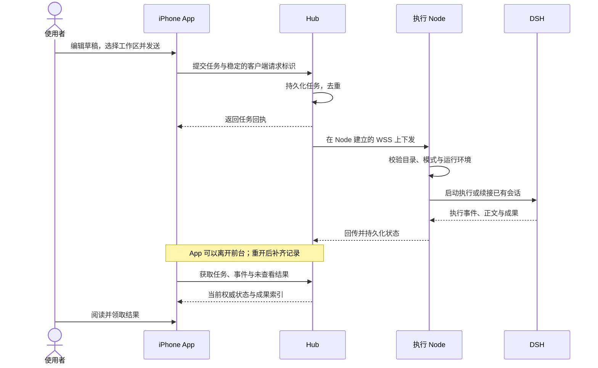
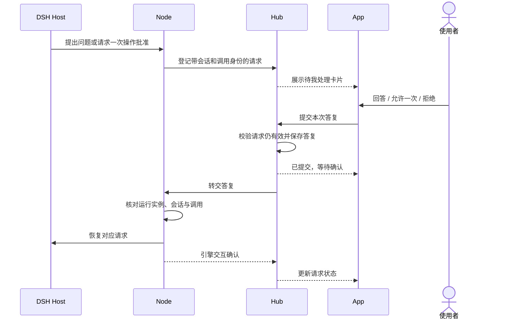
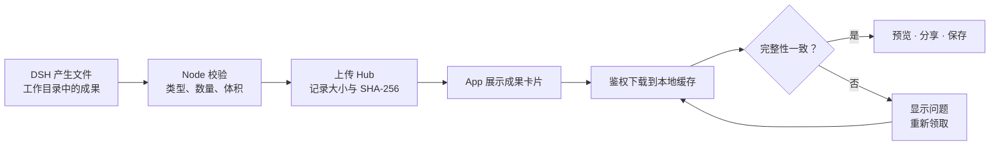
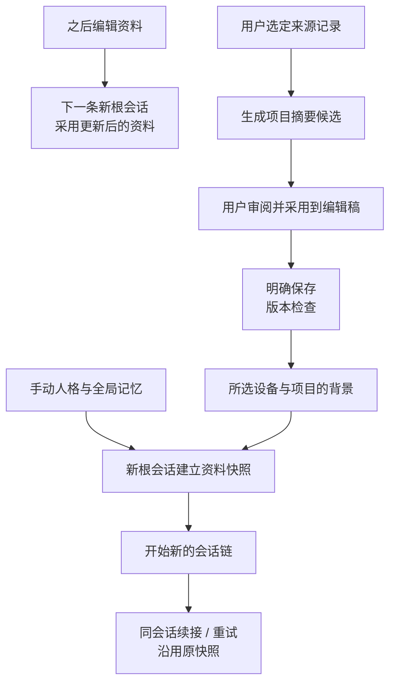

# 一次工作怎样完成

[返回首页](../README.md) · [技术架构](architecture.md) · [接口索引](protocol.md) · [开发进展](progress.md)

这里从用户操作解释任务如何流转。图中的“模型”由 DSH 调用；Hub 不保存或代理模型凭证。具体接口字段以 [协议索引](protocol.md) 和源码为准。

## 1. 交代任务，离开手机，回来领取

客户端在提交回执不明时复用同一个请求标识，避免一次发送重试变成两个任务。已经失败后由用户发起的新重试，与恢复原提交回执是不同操作。

App 的前台流式连接中断后可以回退轮询；重新打开也能从 Hub 获取记录。Node 需要继续在线并保持执行环境可用。手机锁屏不等于执行停止，Node 离线也不等于其子进程已经停止。恢复时先核对已有状态，不静默重新执行未知旧任务。

## 2. 执行途中需要回答或批准

此流程适用于显式启用的 **Host 测试工作区**。默认 headless 路径不具有这套实时交互能力。

批准绑定当前任务、运行实例、会话和工具调用。允许一次不会变成永久批准。已过期、取消或因重启中断的请求不能在新的执行实例上重新生效。重复提交也不能重复执行旧的批准。

界面区分等待用户、已提交、已确认、已取消、已过期和已中断。提交被 Hub 接收只说明答复已经保存；执行端确认仍有独立状态。取消任务和撤销设备身份同样需要承认网络与进程状态可能暂时不一致。

## 3. 想补充一句：当前轮还是下一轮

| 动作 | 语义 | 回执怎样理解 |
| --- | --- | --- |
| 当前轮补充（steer） | 在引擎后续思考步骤中补充方向 | 接收成功不代表已被模型消费；不会立即打断正在运行的工具 |
| 下一轮队列（queue） | 当前轮结束后继续处理下一条要求 | 入队与实际开始执行分别可见 |
| 编辑／删除队列项 | 调整尚可修改的后续要求 | 以服务端确认结果为准 |
| 提前处理队列项 | 使用已经实现的 promote 控制 | 不承诺任意拖拽排序或多任务并行 |

这些操作同样受 Host 模式和请求身份约束。它们让用户可以补充目标，而不必把正在执行的任务删掉重来。跨断线控制回执与重复提交由 Hub 和 Node 共同核对。

## 4. 文件如何真正交到手机

当前每轮最多 4 个一般文件，每个不超过 16 MiB，支持 TXT、MD、CSV、PDF、DOCX。图片使用单独的附件协议，每轮最多 4 张输入与 4 张输出，单张协议上限 6 MiB。

一般文件的任务终态与传输状态分别处理。损坏缓存可以重新领取，无需让模型重新做同一份文件。系统预览和分享帮助把成果带到其他 App；文件的意义、正确性和适用性仍由人检查。一般文档上传作为输入尚未实现。

## 5. 人格、记忆与项目背景怎样延续

全局助理资料包括名称、人格和手动记忆条目；目前最多 20 条。项目背景按设备与项目隔离，包含目标、约束、材料、决定、进展、待解决问题、下一步七个字段。

旧会话保留建立时的资料快照，以免一次设置修改悄悄改写正在执行的上下文。生成摘要和点击“采用”都不会自动保存项目资料。保存遇到版本冲突时保留编辑稿，让用户明确处理最新内容与自己的修改。

删除设置中的一条记忆，不代表历史任务快照、DSH 会话或备份中的同一内容自动消失。自动提取、逐条来源与更细的作用域见 [后续计划](roadmap.md)。

## 6. 接入设备与选择工作区

Node 发起短时配对请求，App 展示设备名称和指纹供用户确认，然后为设备分配独立身份。当前请求有效期为 5 分钟；设备身份与 App 身份、模型凭证各自独立。撤销后的身份不能继续建立受信连接，但这不等同于远程杀死已经存在的进程。

任务始终绑定明确的 `(node_id, project_id)`。默认测试项目不可用时会报告问题，不自动切换到某个真实项目。项目名称与实际路径的登记目前由节点配置管理；在 App 中编辑路径预设、直接选择常用目录是后续工作。

## 阅读这些状态时的几个约定

| 已经发生 | 还不能由此推断 |
| --- | --- |
| Hub 接受了任务 | 执行设备已经开始 |
| 答复或控制命令已提交 | 引擎已经消费或动作已经完成 |
| Node 暂时离线 | 本机进程已经停止 |
| 任务完成 | 所有附件已在手机缓存、内容准确 |
| 通知路由测试通过 | 真实 Apple 推送已经送达 |
| 两个隔离本地节点通过 | 第二物理设备或 Windows 已经验收 |

这套区分同时影响协议、界面和验收记录。更详细的实现入口见 [技术架构](architecture.md)。
